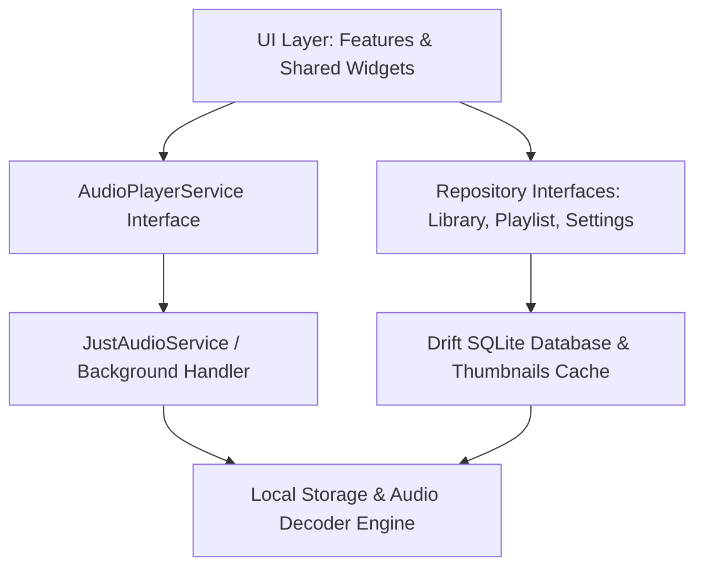

# Vesper

> **A minimal, refined offline music player for Android and Windows. UI quality is the product.**

---

## Highlights

- **Pure Offline Architecture**: Zero network calls, zero tracking, zero telemetry. No `INTERNET` permission in release manifests.
- **Strict Design System**: Built exclusively with design tokens (`lib/core/theme/tokens.dart`). Bundled variable typography (**Sora** for display headings, **Inter** for readable body and numbers).
- **Adaptive Shell**: 
  - **Mobile**: Minimal 3-tab bottom bar with a floating glassmorphic 64 px mini player.
  - **Desktop**: Collapsible navigation rail, custom minimum window size constraints (420x700), and full system media transport (SMTC).
- **Generative Art**: Procedural generative artwork fallback (concentric rings, staggered bars, quarter-circle grids, waves) when embedded ID3 artwork is absent.
- **Instant Scan & Low Memory**: Isolate-based background folder scanner with incremental mtime/size checks and 300 px cached cover thumbnails.
- **20k Track Virtualization**: Constant-time `itemExtent` virtualization and A-Z alphabet scrubber scrolling smoothly at 60/120 fps.
- **Full Queue & State Persistence**: Cold launch restores exact queue, track, position (paused), shuffle, and repeat modes.
- **Synchronized Lyrics**: Millisecond-accurate `.lrc` parser with live lyric highlighting and seek-on-tap.
- **Sleep Timer**: Configurable timers (15m, 30m, 45m, 60m) with clean playback pause.
- **Themes & Accents**: Curated dark theme (`#0D0D11`) and light theme (`#F6F5F2`), with toggleable album-derived ambient gradients or fixed warm gold accents.

---

## Windows Keyboard Shortcuts

| Shortcut | Action |
| :--- | :--- |
| <kbd>Space</kbd> | Toggle Play / Pause |
| <kbd>→</kbd> | Next Track |
| <kbd>←</kbd> | Previous Track |
| <kbd>↑</kbd> | Volume Up (+5%) |
| <kbd>↓</kbd> | Volume Down (-5%) |
| <kbd>M</kbd> | Toggle Mute |
| <kbd>L</kbd> | Toggle Favorite / Like |
| <kbd>Q</kbd> | Open Up Next Queue |

*Note: Shortcuts automatically yield focus when typing into search or text input fields.*

---

## Architecture

Vesper strictly follows clean layered boundaries:



- **Audio Abstraction**: UI depends strictly on `AudioPlayerService` and never touches audio engines or database models directly.
- **Isolated Seek Updates**: Seek bar listens to isolated position streams throttled to ~4 Hz, preventing unnecessary screen rebuilds.
- **Safe Persistence**: Settings, playlists, tracks, albums, and playback history are stored locally in an embedded SQLite database powered by Drift.

---

## Verification & Testing

Verify analyzer correctness and run the comprehensive test suite (including golden tests, isolate scanner tests, persistence tests, and 20k performance tests):

```bash
# Verify formatting
dart format --output=none --set-exit-if-changed .

# Static analysis (zero warnings allowed)
flutter analyze

# Full test suite (41 unit, widget, golden & performance tests)
flutter test
```

---

## Building Releases

### Android APK / App Bundle
```bash
flutter build apk --release
# or
flutter build appbundle --release
```

### Windows Desktop Application
```bash
flutter build windows --release
```

---

## License
MIT. Plays user-owned local audio files only.
